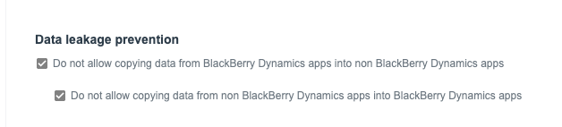

# BlackBerry Dynamics Getting Started Sample App for iOS - Swift

This sample pairs with 'GettingStarted-Swift' to provide an example of an iOS app before and after integrating with the BlackBerry Dynamics SDK. 

## Description

The samples demonstrate features commonly used in BlackBerry Dynamics applications including:-
- Secure file storage
- Secure database
- Secure communication (HTTP/S and Socket)

## Requirements

See [Software Requirements](https://docs.blackberry.com/en/development-tools/blackberry-dynamics-sdk-ios/current/blackberry-dynamics-sdk-ios-devguide/gwj1489687014271/vcw1490294551674) of the BlackBerry Dynamics SDK (iOS) 

## SDK integration (Swift Package Manager)

This project references the BlackBerry Dynamics iOS SDK as a Swift package:

Package: BlackBerry Dynamics iOS SDK
URL: `https://github.com/blackberry/BlackBerry-Dynamics-iOS-SDK`

Linked products:

- **BlackBerryDynamics** — main application target
- **GSEProvider** — main application target
- **BlackBerryDynamicsAutomatedTestSupportLibrary** — UI test target (if present)

The project references the package on the default branch and resolves the **latest** SDK when you build or run **File → Packages → Resolve Package Versions**.

## How To Build and Deploy

1. Set up your [BlackBerry Dynamics development environment](https://developers.blackberry.com/us/en/resources/get-started/blackberry-dynamics-getting-started).
2. Clone this repository.
3. Open **GettingStarted-Dynamics-Swift.xcodeproj** in Xcode.
4. Resolve packages: **File → Packages → Resolve Package Versions**.
5. Edit the **Bundle Identifier** to your own.
6. Edit **URL identifier** and **URL Schemes** in `Info.plist` per [Declaring a URL type](https://docs.blackberry.com/en/development-tools/blackberry-dynamics-sdk-ios/current/blackberry-dynamics-sdk-ios-devguide/gwj1489687014271).
7. Set **GDApplicationID** in `Info.plist` (default export value: `com.blackberry.dynamics.sample`).
8. Assign the app entitlement to a user in UEM. See [Add an internal BlackBerry Dynamics app entitlement](https://docs.blackberry.com/en/endpoint-management/blackberry-uem/current/managing-apps/managing-blackberry-dynamics-apps).
9. Build and run on a simulator or device.

For more information, see [Get Started with BlackBerry Dynamics](https://developers.blackberry.com/us/en/resources/get-started/blackberry-dynamics-getting-started).

## How to test Share Sheet DLP Example

 `ShareViewController.swift`  is updated by `AppDelegate.swift` when changes to the users/app Dynamics Policy Configuration occur. 
 When `GDAppConfigKeyPreventDataLeakageIn` is `true`, the application cannot import data from other applications or services. 
 When `GDAppConfigKeyPreventDataLeakageOut` is `true`, the application cannot share data to other applications. 
 _[Documentation](https://developer.blackberry.com/devzone/files/blackberry-dynamics/ios/interface_g_di_o_s.html#a3265c6148406a8850ba673b26e472ece)_
 
 You can test this functionality by creating a `BlackBerry Dynamics Profile` under `Policies and Pofiles` in your UEM Console. Configure two profiles. One profile can be named as `Enabled DLP`, and the other,`Disable DLP`. 
 
 

 You can assign different DLP settings to a test user after the application is activated. When the DLP setting is applied, you can navigate to the `ShareViewController.swift` on your app, and attempt to share under both cases. 

## License

Apache 2.0 License

## Disclaimer

THE SOFTWARE IS PROVIDED "AS IS", WITHOUT WARRANTY OF ANY KIND, EXPRESS OR IMPLIED, INCLUDING BUT NOT LIMITED TO THE WARRANTIES OF MERCHANTABILITY, FITNESS FOR A PARTICULAR PURPOSE AND NONINFRINGEMENT. IN NO EVENT SHALL THE AUTHORS OR COPYRIGHT HOLDERS BE LIABLE FOR ANY CLAIM, DAMAGES OR OTHER LIABILITY, WHETHER IN AN ACTION OF CONTRACT, TORT OR OTHERWISE, ARISING FROM, OUT OF OR IN CONNECTION WITH THE SOFTWARE OR THE USE OR OTHER DEALINGS IN THE SOFTWARE.

 
